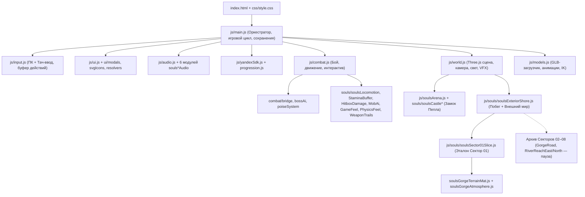
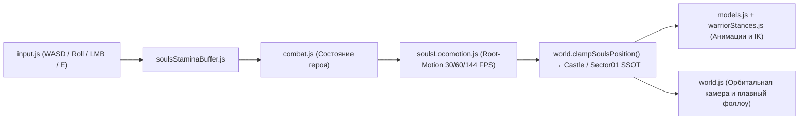
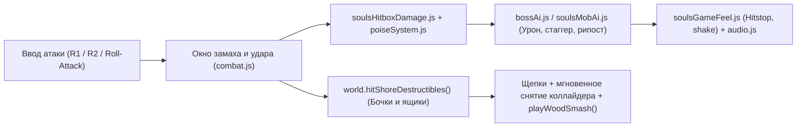
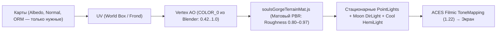
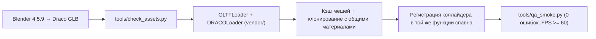

# Grimborne Hunters — Архитектура проекта (`GAME_ARCHITECTURE`)

## 1. Общая структура модулей (реальная карта импортов)
Весь код игры находится в `D:\GrimborneHunters\js\` и загружается нативными ES-модулями без сборки.

## 2. Игровые потоки данных

### 2.1. Ввод → Движение → Физика → Анимация → Камера

### 2.2. Атака → Хитбокс → Урон / Разрушение → Реакция

### 2.3. Материалы и рендер окружения

### 2.4. Конвейер загрузки ресурсов

## 3. Архитектурные правила роста (как избегать техдолга)
1. **Не раздувать 4 монолита** (`combat.js` 11.6k, `models.js` 11.6k, `css/style.css` 11.2k, `world.js` 9.4k). Любая новая подсистема (новый сектор, новый тип врага, механика костра, новый тип интерактива) пишется **отдельным ES-модулем** до `1 500` строк и подключается в монолит через 5–15 строк делегирования.
2. **Единый источник истины (SSOT):** геометрия мира, высоты `evalGroundY`, типы поверхностей `evalSurfaceType` и коллизии `clampPosition` одного сектора обязаны жить в одном модуле сектора.
3. **Запрещено динамически создавать/удалять `PointLight` в кадре** (вызывает компиляцию шейдеров и фризы) — использовать заранее созданные стационарные источники света и менять только их `intensity`.
4. **Запрещены внешние CDN-запросы** во время игры — все библиотеки (`Three.js`, `GLTFLoader`, `DRACOLoader`, `draco_wasm_wrapper`) лежат локально в `vendor/`.
5. **Чистота памяти (VRAM):** все созданные геометрии/материалы/текстуры регистрируются через `trackGeo` / `trackMat` / `trackTex` и освобождаются в `dispose()`.
