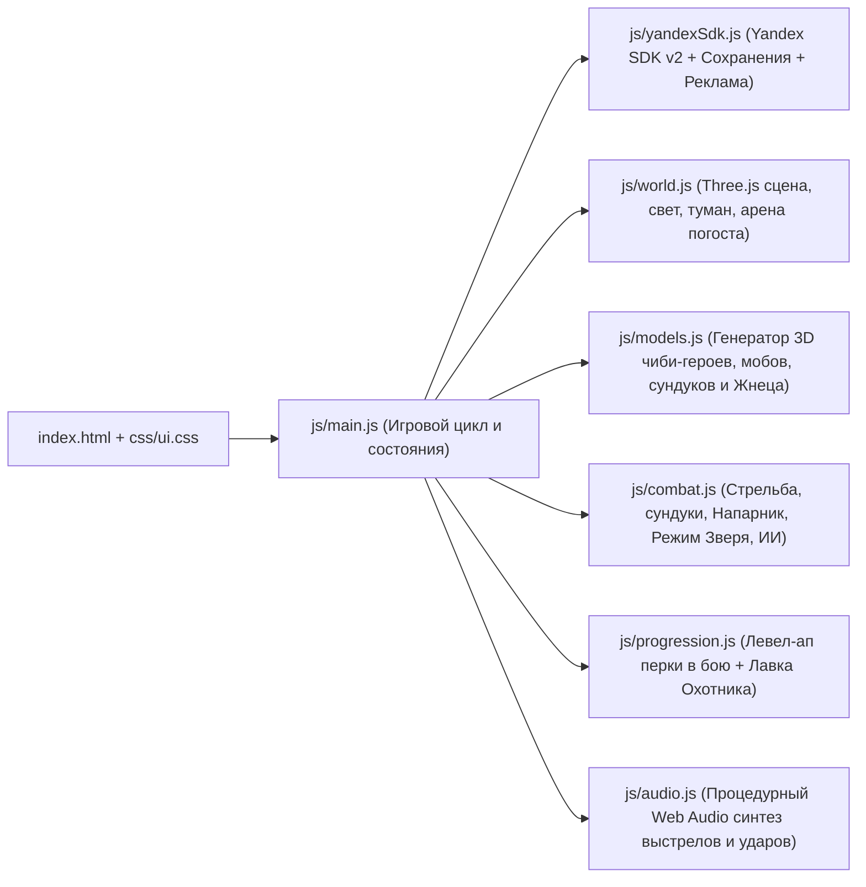

# План разработки: «Охотники Мрака» (Minigore 2 × Тёмное фэнтези) для Яндекс Игр

По итогам нашего обсуждения зафиксированы ключевые решения и оптимальные настройки по деталям геймплея, управления и интеграции с Яндекс Играми. Проект создаётся **полностью с нуля** в новой папке `C:\Users\peter\.gemini\antigravity\scratch\grimborne-hunters`.

---

## 1. Ключевые решения по проекту

| Направление | Выбранное решение |
| :--- | :--- |
| **Платформа и стек** | **Three.js + модульный ES6 JavaScript + Web Audio API** — мгновенная загрузка (1–2 сек), 60 FPS на ПК и смартфонах (включая Mobile Safari), готовая сборка в один ZIP-архив для консоли Яндекс Игр. |
| **Визуальный стиль** | **Блочные 3D чиби-персонажи** в духе *Minigore 2*: крупная выразительная голова-куб со шляпой/капюшоном/шлемом, компактное тело, честные 3D-тени, отдача оружия, гильзы, вспышки и сочный разлёт вокселей. |
| **Сеттинг** | **Тёмное фэнтези (возрастной рейтинг 12+)**: проклятый погост в тумане, охотники на нечисть, скелеты, чумные культисты-маги, адские гончие и древний **Босс-Жнец с огромной косой**. |
| **Структура забега** | **Гибрид Minigore 2 + Roguelite**: сундуки с оружием, напарники и трансформации прямо на арене + сбор душ (XP) с выбором 1 из 3 случайных благословений при повышении уровня в бою + мета-лавка за золото между забегами. |

> [!TIP]
> **Почему визуал гарантированно получится аккуратным:** в отличие от сложной 2D-анатомии на Canvas, блочные 3D чиби-модели собираются из чётких геометрических воксельных групп в `Three.js` (голова, торс, ножки, точка крепления оружия в руках). Выразительность достигается за счёт наклона при беге, пружинистого подпрыгивания, отдачи при выстреле, динамического света от выстрелов и частиц.

---

## 2. Игровые механики вертикального среза (MVP)

### Управление (ПК + Мобильные браузеры)
- **На ПК:** перемещение на `WASD` / стрелки, прицеливание курсором мыши + кнопка переключения **умного автоприцела** (`Q` или клик по иконке на HUD), чтобы можно было играть даже одной рукой.
- **На смартфонах и планшетах:** адаптивные виртуальные двойные стики (левый — движение, правый — ручной огонь) + режим автострельбы по ближайшей угрозе при отпущенном правом стике.

### Фирменные механики арены (адаптация *Minigore 2*)
1. **Оружейные сундуки на карте (готический порох и руны):**
   - Базовое бесконечное оружие охотника (например, парные арбалеты) дополняется мощными пушками с ограниченным боезапасом из сундуков: **Двуствольный мушкетон (дробовик)**, **Картечница Гатлинга (миниган)**, **Рунный огнемёт**, **Чумная мортира (взрывные снаряды)**.
   - Сундук на земле визуально уменьшается пропорционально остатку патронов. Если расстрелять сундук — он раскаляется докрасна и **взрывается кольцом снарядов**, зачищая толпу вокруг.
2. **Сундук Напарника:**
   - Призывает боевого чиби-спутника (оруженосца с мушкетом или боевого ворона-фамильяра), который следует за героем и помогает отстреливать орду.
3. **Цветные элитные враги и «Режим Зверя»:**
   - **Фиолетовые культисты** гарантированно роняют сундук с оружием или сундук напарника.
   - **Синие призрачные скелеты** роняют сердца здоровья и **Кровавые клеверы-печати**. Сбор **3 печатей** запускает **Режим Зверя**: герой временно превращается в огромного неуязвимого оборотня-охотника с горящими глазами и давит орду тараном на высокой скорости.
4. **Прокачка внутри забега + Босс-Жнец:**
   - По мере заполнения шкалы душ игра ставит мягкую паузу и предлагает **1 из 3 случайных перков** (разрывные болты, цепная молния, вампиризм, ускорение перезарядки, усиление напарника, дополнительное сердце и др.).
   - На исходе таймера волны темнеет небо и на арену выходит **Древний Жнец с косой** с тремя читаемыми магическими атаками (круговой взмах косы с рывком, телеграфируемые круги тёмного пламени на земле и призыв костяной стражи).
5. **Лавка Охотника (мета-прогрессия):**
   - Между забегами за собранное золото качаются базовые характеристики (здоровье, урон, скорость, длительность Режима Зверя) и открываются **3 охотника**: *Охотник на ведьм*, *Чумной алхимик* и *Железный инквизитор*.

---

## 3. Архитектура проекта и требования Яндекс Игр

> [!IMPORTANT]
> **Соответствие чеклисту модерации Яндекс Игр:**
> - Никаких блокировок при локальном тестировании: обёртка `yandexSdk.js` автоматически переключается на безопасный мок + `localStorage`, если глобальный объект `YaGames` недоступен.
> - Вызов `ysdk.features.LoadingAPI.ready()` строго в момент готовности главного меню.
> - Мгновенное отключение звука (`AudioContext.suspend()`) и автопауза боя при сворачивании вкладки (`visibilitychange` / `blur`) и на время показа полноэкранной или Rewarded-рекламы.
> - Отсутствие выделения текста, контекстного меню правого клика и скролла/зума страницы на мобильных экранах.
> - Поддержка русского и английского языков (`RU` / `EN`) по `ysdk.environment.i18n.lang`.

### Структура файлов (`C:\Users\peter\.gemini\antigravity\scratch\grimborne-hunters`)
- `index.html` — разметка канваса, HUD (сердца, патроны, счётчик печатей Зверя, таймер до Жнеца, полоска XP), карточки выбора перков, экран Лавки Охотника и виртуальные стики.
- `css/style.css` — готический UI в тёмно-золотых и багровых тонах, адаптивная вёрстка под горизонтальные и вертикальные экраны смартфонов.
- `vendor/three.module.js` — локальная копия `Three.js` (чтобы архив для Яндекс Игр не зависел от внешних CDN — внешние сетевые запросы запрещены правилами площадки!).
- `js/i18n.js` — словари `RU` и `EN`.
- `js/yandexSdk.js` — инициализация `YaGames`, облачные данные игрока (`player.getData/setData` + `localStorage`), `showFullscreenAdv` и `showRewardedVideo` (возрождение с полными сердцами, удвоение золота после боя, бонусный сундук золота в лавке).
- `js/audio.js` — сочный синтез выстрелов мушкета/гатлинга/огнемёта, звона гильз, взрыва сундуков, рёва Зверя и ударов косы Жнеца с автопаузой.
- `js/models.js` — модульная сборка блочных 3D чиби-моделей охотников, нежити, элитных культистов, оборотня, сундуков, надгробий, мёртвых деревьев и Босса-Жнеца с косой.
- `js/world.js` — освещение, мягкие тени, туман проклятого погоста, система частиц (вспышки, гильзы, воксельные осколки, круги телеграфов босса) и тряска камеры (`screen shake`).
- `js/progression.js` — база из 3 героев, мета-улучшений Лавки и 10 боевых благословений при повышении уровня.
- `js/main.js` — связка игрового цикла, волнового спавнера, логики сундуков, напарника, Режима Зверя и фаз боя со Жнецом.

---

## 4. Проверка и тестирование
1. Скачивание локальной копии `three.module.js` внутрь `vendor/`, чтобы сборка работала полностью автономно для загрузки в Яндекс Игры.
2. Запуск локального HTTP-сервера и живая проверка игры через встроенный браузер:
   - проверка визуала 3D-арены, пропорций чиби-героев, теней и читаемости UI;
   - тест стрельбы, взрыва сундуков, призыва напарника, трансформации в Режим Зверя, окна выбора перков при левел-апе и выхода Босса-Жнеца;
   - проверка отсутствия ошибок в консоли и корректной работы моков Yandex SDK (возрождение за рекламу и сохранение прокачки).
